# The RPG · 玩法机制与实现原理图解

策划沟通版 v1.0 · 2026-10-19 · 基于当前工作区代码、配置与场景

这份说明从“玩家做什么”讲到“系统如何响应”，用于理解现有玩法、讨论手感和安排后续设计。图中主流程经过简化；具体限制、数值和场景差异写在对应章节中。本文是现状说明，不替代试玩验收。

## 01 · 一张树看懂项目

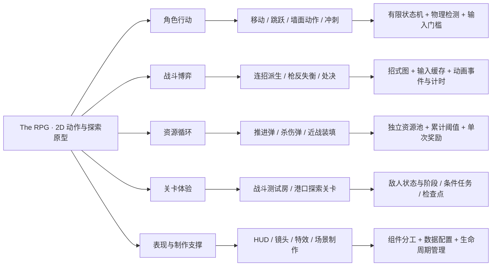

**现有设计重心：** 用移动与冲刺调整位置，用近战制造伤害并积累弹药，用枪反抓住敌人窗口，再用处决兑现机会。港口关卡则复用角色能力，以探索、机关和离港目标组织体验。

### 三个场景的职责

| 场景 | 当前用途 | 应如何理解 |
| --- | --- | --- |
| SampleScene | 通用角色与战斗基线，普通骷髅、HUD | 移动和战斗系统的基础样本；当前正式构建列表仅启用它 |
| 暮色庭院 · 战斗测试房 | 固定三招精英、胜败判定、暂停和重开 | 用于反复检验战斗节奏的独立实验场 |
| 月潮港 · 最后一班船 | 凭证、绞盘、登船、收藏、检查点 | 探索关卡；没有敌人 AI，保留原战斗能力和可击打货箱 |

**范围说明：** 通用模块存在，不代表所有场景都在使用。例如港口能攻击货箱，但没有枪反敌人；通用循环视差脚本与港口专用镜头也不是同一套实现。

## 02 · 角色为什么需要状态机

**策划目的：** 让角色在不同动作中有不同的操作权限、速度和结束条件。站立、攻击、冲刺、处决各自维护自己的规则，避免所有动作都同时控制角色。

**原理：有限状态机（FSM）。** 每个实体持有一个“当前状态”；正常切换顺序是“退出旧状态 → 进入新状态”，每帧更新当前状态。进入负责初始化，持续更新负责执行与判断，退出负责收尾。

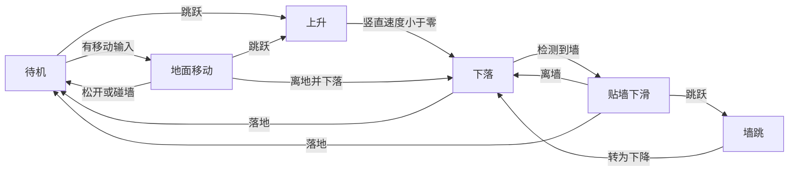

这是移动主路径。角色共有 12 个具体状态，另有复用规则的父类：

```text
EntityState：进入 / 更新 / 退出 / 动画参数 / 计时
└─ PlayerState：玩家共享动画参数与冲刺输入
   ├─ GroundedState：地面通用判断（代码父类）
   │  ├─ Idle：待机
   │  └─ Move：移动
   ├─ AiredState：空中控制（代码父类）
   │  ├─ Jump：上升
   │  └─ Fall：下落
   ├─ WallSlide / WallJump：墙滑 / 墙跳
   ├─ Dash：推进冲刺
   ├─ Attack / JumpAttack：地面攻击 / 空中攻击
   ├─ CounterAttack：枪反
   ├─ Execution：处决
   └─ Dead：死亡
```

这里采用“单一当前状态 + 父类复用公共逻辑”，没有维护同时运行的父子状态栈，不宜直接称为完整的层级状态机。

| 动作 | 主要进入门槛 | 执行与退出 |
| --- | --- | --- |
| 地面攻击 | 地面待机或移动时按左键 | 读取当前招式，动画结束后衔接已缓存招式或回待机 |
| 空中攻击 | 上升或下落时按左键 | 落地触发后半段动画，落地且收到结束事件后回待机；当前动画未接入伤害事件 |
| 推进冲刺 | 有推进弹，未死亡、未受击位移、未处决等；通常不能贴墙启动 | 锁定方向、暂时关重力；时间结束按落地情况回待机或下落，撞墙可提前结束 |
| 枪反 | 有杀伤弹，状态允许；常规输入入口在地面状态 | 进入时做一次命中查询；空枪计时结束，成功表现依动画结束事件退出 |
| 处决 | 在地面、未受击位移、非冲刺等，并找到有效失衡目标 | 锁定动作并计时；结束或目标失效后释放 |
| 死亡 | 生命归零 | 禁用玩家基础输入与刚体模拟，关闭状态切换；重生交给场景流程 |

**移动判定方法：** Rigidbody2D 速度控制 + 一条向下地面射线 + 上下两条墙面射线。墙面要求两条射线同时命中。空中移动按倍率减弱；朝向用左右方向值统一驱动视觉翻面和检测方向。

**可调项：** 移速、跳跃初速度、空中控制倍率、墙滑倍率、墙跳速度、冲刺速度与持续时间。它们会影响平台距离、躲避空间与攻击接近节奏。

依据：[状态调度](../../Assets/Scripts/StateMachine/StateMachine.cs)、[玩家动作入口](../../Assets/Scripts/Player/Player.cs)、[状态目录](../../Assets/Scripts/Player/PlayerStates)、[实体检测与速度](../../Assets/Scripts/Entity/Entity.cs)。

## 03 · 普攻从固定连段变成招式图

**策划目的：** 让同一起手式有不同后续选择，并让输入节奏产生意义。

**原理：数据驱动的招式有向图 + 单槽输入缓存。** 一个招式节点保存攻击配置、动画下标、普通后续、替代后续和接受输入的时间窗。当前配置的连线如下：

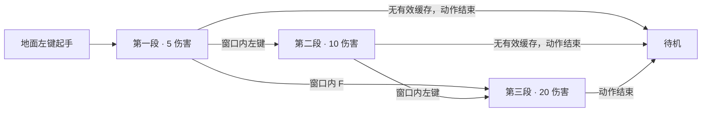

这里的 F 是“选择当前招式的替代后续”，不是一套独立的起手攻击。第二段没有 F 派生，第三段没有任何后续。

### 输入不是立即切招

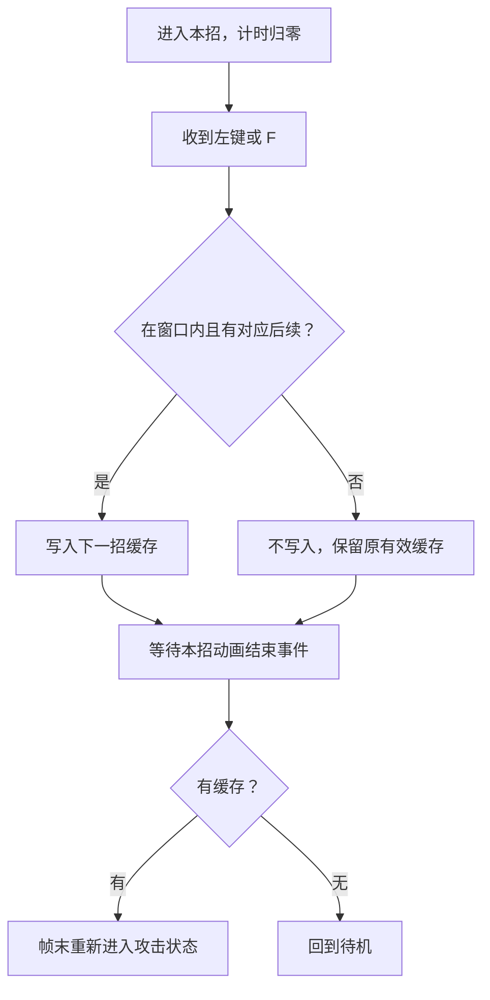

| 招式 | 伤害 | 判定半径 | 冲击等级 | 每名有效受伤敌人的装填值 | 派生窗配置 |
| --- | --- | --- | --- | --- | --- |
| 第一段 | 5 | 1 世界单位 | 0：无受击位移 | 10 | 0.2～0.6 秒 |
| 第二段 | 10 | 1 世界单位 | 1：击退 | 10 | 0.2～0.6 秒 |
| 第三段 | 20 | 1 世界单位 | 2：击飞 | 15 | 0.2～0.6 秒，但没有后续节点 |

**窗口与动画共同决定手感：** 第二段动画的结束事件在片段 0.25 秒，默认正常播放速度下，实际可接招时间约为 0.2～0.25 秒。配置写到 0.6 秒，不会让已经结束的动作继续接受输入。调整动画速度后也应重新核对，因为输入窗使用游戏秒数。

**冲突规则：** 不同帧以最后一次有效输入为准；同帧左键与 F 都有效时，后处理的 F 优先。窗口外输入和没有对应后续的输入不清除已有缓存。冲刺、处决或死亡会取消排队中的延迟连招。

**可调项：** 招式连线决定可选路线；窗口决定输入宽容度；动画长度决定动作承诺与衔接节奏；攻击位移决定贴身程度。添加节点仍需配好动画与位移，当前不是任意招式都能自动运行的可视化编辑器。

依据：[攻击状态](../../Assets/Scripts/Player/PlayerStates/Player_AttackState.cs)、[招式节点定义](../../Assets/Scripts/Combat/Attack_MoveDefinition.cs)、[当前招式资产](../../Assets/Data/Combat/Attacks/Rapier)、[第二段动画](../../Assets/Animations/Player_Animations/Player_Attack_1.anim)。

## 04 · 一次攻击怎样变成真实伤害

**策划目的：** 让出招画面、命中时点、伤害与奖励相互对应。

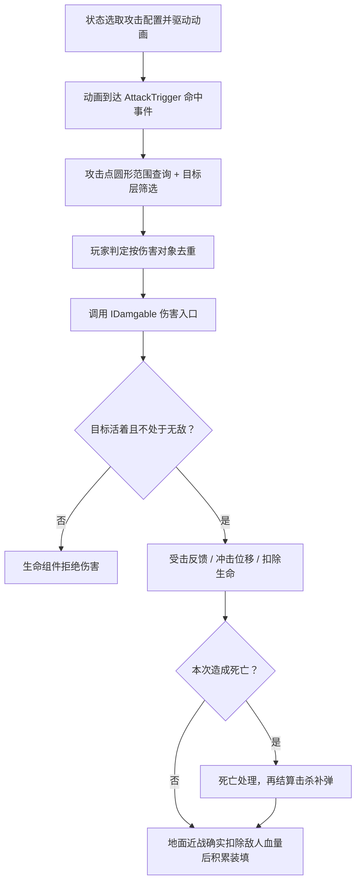

**接口的作用：** `IDamgable` 表示“可接受伤害”。敌人生命、旧宝箱和港口货箱可以接到同一类攻击，但各自响应不同：敌人扣血，旧宝箱开箱，港口货箱损坏。`ICounterable` 另外表示“可以被枪反”，不会因为能受伤就自动能被反击。

**冲击与伤害分离：** 冲击 0 只走伤害与反馈；1 使用击退速度与持续时间；2 使用击飞参数；3 是预留倒地值，当前没有倒地状态或位移。受击位移由协程和 `isKnocked` 管理，不是独立的玩家受击 FSM 状态。

**去重的准确范围：** 玩家普攻的 HashSet 在每次 `PerformAttack` 调用中去重，防止同目标多个碰撞体在该次查询重复结算；它不保证多次动画事件之间也只命中一次。测试精英则保存整招共用的集合，在连续有效帧中也只处理同一目标一次。

**三种时序驱动并存：** 普攻和普通骷髅主要靠动画事件；枪反进入状态时查询一次；处决和测试精英使用代码计时。C# FSM 管行为规则，Animator 管画面播放，不能把两者看成同一个状态机。

依据：[伤害查询](../../Assets/Scripts/Entity/Entity_Combat.cs)、[生命与无敌门槛](../../Assets/Scripts/Entity/Entity_Health.cs)、[冲击响应](../../Assets/Scripts/Entity/Entity_HitReaction.cs)、[动画事件桥接](../../Assets/Scripts/Entity/Entity_AnimationTriggers.cs)。

## 05 · 枪反与处决：创造机会，再兑现机会

**策划目的：** 鼓励观察敌人动作，承担耗弹风险，换取一段稳定的反击机会。

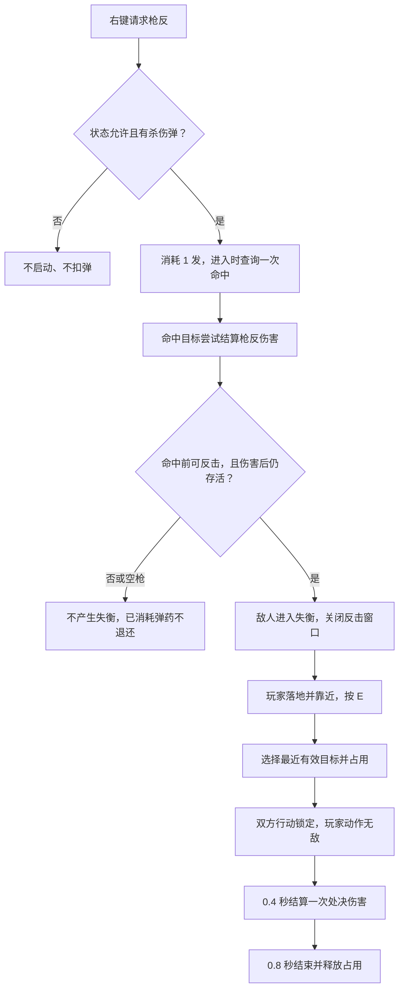

枪反不是持续等待敌人打来的防御罩：当前进入枪反状态时立即查询一次范围。没有可反击窗口时，命中仍会尝试造成伤害；能否造成失衡另看敌人窗口和生存状态。SampleScene 中枪反基础伤害为 10，空枪状态计时为 0.2 秒。

**处决门槛：** 目标活着、正在失衡、组件有效且未被占用；玩家在地面且自身状态允许。目标从当前攻击范围内选择，优先距离最近者。E 处决本身不扣杀伤弹，因此可以在空仓时利用已经制造出的失衡。

**当前处决配置：** 第一段普攻伤害 × 5，现有第一段为 5，所以当前基础处决伤害为 25；冲击等级 0。开始时保存本次时长、伤害与动画参数，动作中途改资产不会改写已启动的这一击。

**原理：目标占用 + 配置快照 + 单次结算标记 + 统一收尾。** 占用防止目标同时被别的处决拿走；`settled` 防止重复伤害；先处理命中时点再处理结束时点，避免卡顿跨过 0.4 / 0.8 秒时漏伤害。正常结束、禁用或目标失效都会走释放逻辑，恢复相关重力与无敌设置；死亡由死亡流程接管。

普通骷髅当前失衡 1 秒，测试精英为 2.8 秒。处决已使用独立的 `Execution` 动画入口，但画面仍是枪反姿势的占位动画；尚未按武器或弹仓选择不同动作。

依据：[枪反查询](../../Assets/Scripts/Player/Player_Combat.cs)、[处决会话](../../Assets/Scripts/Player/Player_Execution.cs)、[目标占用](../../Assets/Scripts/Enemy/Enemy_ExecutionTarget.cs)、[实际处决配置](../../Assets/Data/Combat/Execution/Execution_01.asset)。

## 06 · 双弹药与近战装填：三条补给路径

**策划目的：** 将移动容错和攻击反制拆成不同资源，同时让近战输出能够恢复枪反机会。

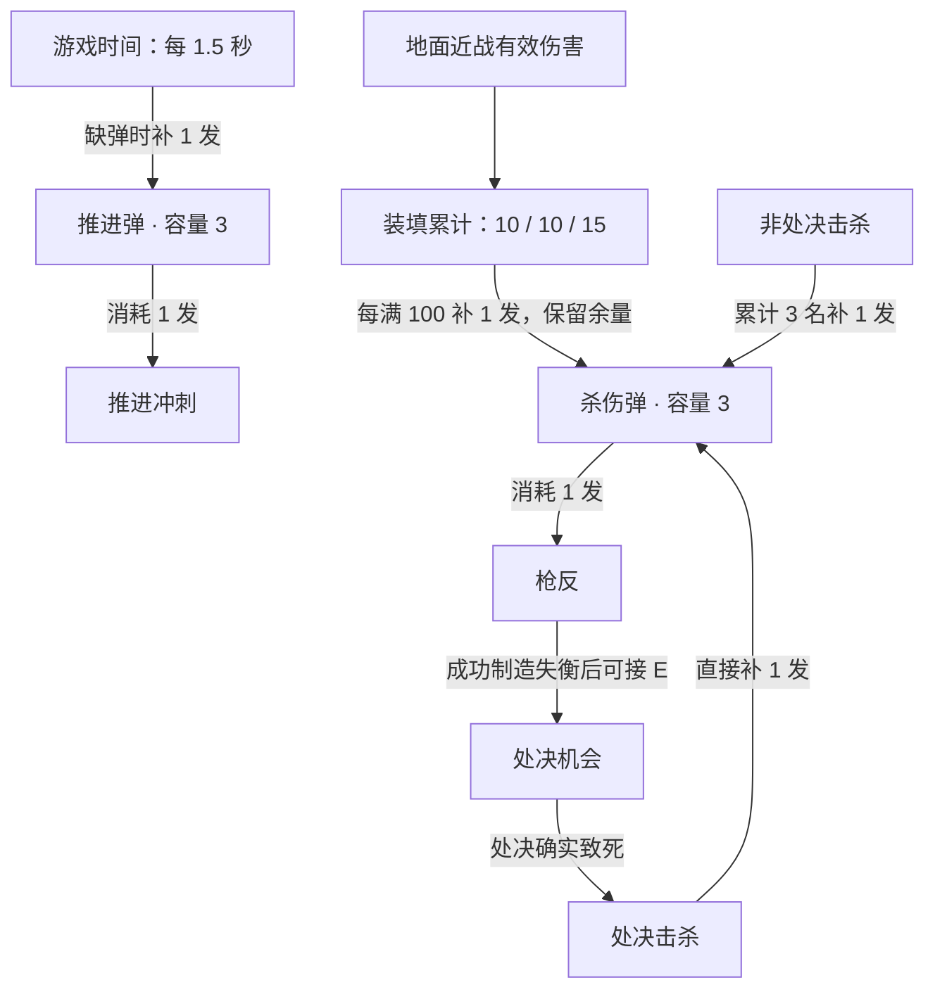

| 资源 | 消耗 / 获得规则 | 需要注意的边界 |
| --- | --- | --- |
| 推进弹 | Dash 成功启动扣 1；缺弹时每 1.5 游戏秒回 1 | 连续消耗不重置已进行的回弹计时；暂停时不回复 |
| 杀伤弹 | 枪反成功启动扣 1；空枪也扣 | 不随时间自动回复；与推进弹相互独立 |
| 普通击杀计数 | 非处决击杀每 3 名回 1 发杀伤弹 | 处决击杀不增加、不清空此计数；满仓时完成的奖励不会储存 |
| 处决击杀奖励 | 处决确实击杀时回 1 发杀伤弹 | 没杀死、被拒绝、失去目标或取消均不回弹，不叠加普通击杀奖励 |
| 近战装填 | 地面普攻对每名实际受伤敌人增加 10 / 10 / 15；每满 100 回 1 | 满仓暂停新积累，保留已有进度；中断、受伤、换目标不清零 |

**实例一：** 装填进度 95，杀伤弹尚有空位，第三段有效命中一名敌人：95 + 15 = 110，补一发后保留 10。

**实例二：** 已累计两名普通击杀，枪反后处决杀死一名敌人：处决只回一发，普通击杀计数仍为 2。接下来再普通击杀一名，才触发三杀回弹。

**同次致死命中的顺序：** 先结算击杀奖励，再根据剩余弹仓空间增加近战装填。击杀奖励已经填满弹仓时，这次不再增加装填；还有空位时，两条奖励可以同次发生。

**推进的保护范围：** 当前 Dash 持续 0.25 秒、开始后最多 0.12 秒伤害无敌；无敌不是整个 Dash，也不会关闭地形碰撞。处决则使用另一种“动作期间无敌”标记。

依据：[推进弹](../../Assets/Scripts/Player/Resources/Player_PropulsionAmmo.cs)、[杀伤弹](../../Assets/Scripts/Player/Resources/Player_LethalAmmo.cs)、[装填进度](../../Assets/Scripts/Player/Resources/Player_ReloadProgress.cs)、[死亡奖励](../../Assets/Scripts/Enemy/Enemy_Health.cs)、[无敌组件](../../Assets/Scripts/Entity/Entity_Invulnerability.cs)。

## 07 · 敌人行为：普通状态机与精英阶段制

**策划目的：** 普通敌人提供可理解的巡逻、发现和追击；测试精英提供可重复练习的出招节奏。

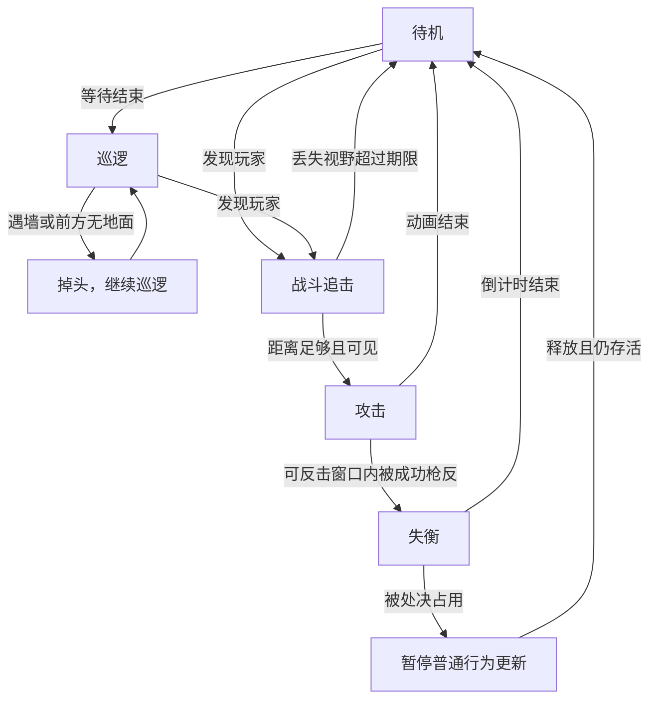

普通敌人通过朝向射线检测玩家，地形可以遮挡视线；进入战斗后按水平距离追击与攻击，短暂失去视野时保留追击记忆。死亡是独立的终止分支：停止正常切换，击飞、透明渐隐，最后销毁对象。图中不重复绘制每个状态到死亡的连线。

**这里没有使用行为树或导航寻路。** 现有普通 AI 是有限状态机、射线感知与距离条件。巡逻中的边缘掉头不等于战斗追击也具备完整的悬崖规避。

### 测试精英：固定出招循环 + 攻击阶段

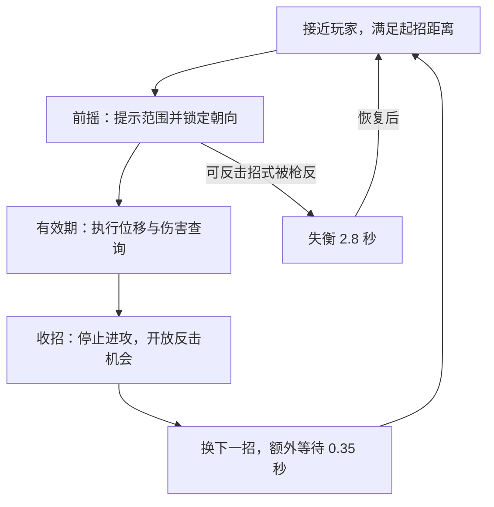

| 固定顺序 | 前摇 | 有效期 | 收招 | 伤害 | 应对窗口 |
| --- | --- | --- | --- | --- | --- |
| 横斩 | 0.70 秒 | 0.18 秒 | 0.80 秒 | 12 | 金色提示，前摇可枪反；也可后退或冲刺 |
| 突进 | 0.90 秒 | 0.42 秒 | 0.95 秒 | 16 | 金色提示，前摇可枪反；跳跃或冲刺回避 |
| 重砸 | 1.15 秒 | 0.22 秒 | 1.20 秒 | 22 | 红色提示，不可枪反；跳跃避开低位范围 |

顺序为横斩 → 突进 → 重砸 → 循环；开局另有 2 秒准备时间。出招锁定朝向；突进实际判定随身体移动，其前摇路线提示是较长的预告范围。代码用矩形范围查询，整招记录已处理的目标，避免有效期每帧重复扣血。

精英继承现有骷髅能力，替换战斗和攻击状态，保留失衡、处决和死亡支持。三招复用一套攻击图，靠时序、位移和提示区分；测试动画移除了原伤害事件，避免与阶段计时重复结算。

**可调项：** 起招距离、前摇 / 有效期 / 收招时长、伤害、范围、可反击招式和失衡时间。精英时序目前写在脚本数组里，尚未提取成独立策划配置资产。

依据：[普通敌人](../../Assets/Scripts/Enemy/Enemy.cs)、[敌人状态](../../Assets/Scripts/Enemy/EnemyStates/Enemy_Skeleto)、[测试精英](../../Assets/Scenes/CombatTest/Runtime/Enemy_TestElite.cs)、[精英预制体](../../Assets/Scenes/CombatTest/Prefabs/GraveWarden.prefab)。

## 08 · 港口关卡：条件推进与可选探索

**策划目的：** 用清晰目标串起一条探索路线，并允许玩家选择收集和检查点，减少失败后的重复劳动。

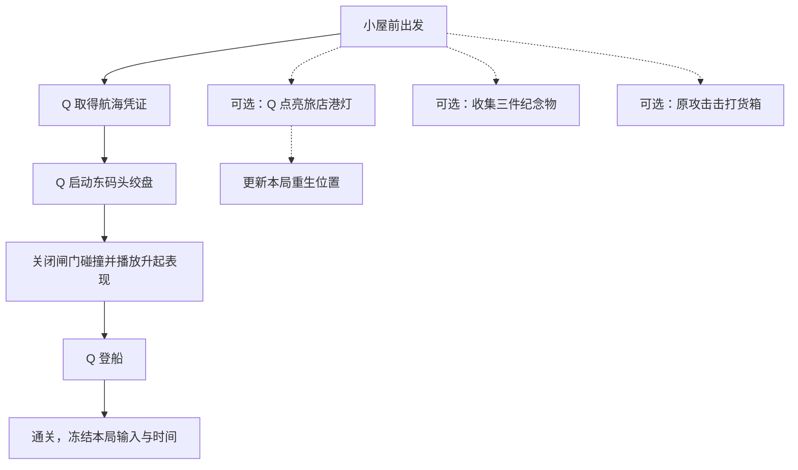

**原理：任务标志 + 条件门控。** `HasPermit` 决定能否开绞盘，`HasPermit && GateOpen` 决定能否登船。`HarborPoint.Kind` 区分凭证、检查点、绞盘、船与纪念物；进入范围后选取最近交互点，按 Q 执行对应规则。

港灯不是强制通关步骤，三件纪念物也不是登船门槛。开绞盘时立即关闭闸门碰撞，视觉随后升起；因此实际通行与动画完成并不绑定。

### 复活和重开保留什么

| 数据 / 对象 | 死亡或落水后复活 | R 重开整局 |
| --- | --- | --- |
| 角色、生命、弹药、装填、动作状态 | 销毁旧角色，实例化完整新角色 | 同样生成新角色 |
| 出生位置 | 当前检查点，未点灯则初始位置 | 初始小屋位置 |
| 凭证、闸门、纪念物 | 保留 | 清空并重置交互点 |
| 货箱受损状态 | 保留 | 重置 |
| 用时与失败次数 | 用时继续、次数增加；界面将死亡也计入“落水” | 归零 |

这是场景内存中的进度保留，没有写入磁盘存档，也没有通用任务数据库或背包。通过销毁再实例化角色，生命、FSM、弹药和处决占用能随组件初始化恢复。

**战斗测试房的区别：** 重开会同时重建玩家和精英，恢复一整场对战；港口普通复活只换玩家并保留世界进度。两者暂停都结合 `Time.timeScale = 0` 与禁用输入动作，避免游戏停了但独立攻击输入仍触发。

依据：[港口任务与重生](../../Assets/Scenes/HarborVillageV2/Runtime/HarborQuest.cs)、[交互点](../../Assets/Scenes/HarborVillageV2/Runtime/HarborPoint.cs)、[货箱](../../Assets/Scenes/HarborVillageV2/Runtime/HarborCrate.cs)、[战斗回合管理](../../Assets/Scenes/CombatTest/Runtime/CombatTestRoom.cs)。

## 09 · HUD、镜头与反馈怎样服务玩法

| 玩家需要知道什么 | 现有表现 | 使用的方法 |
| --- | --- | --- |
| 还能承受多少攻击 | 玩家血条、敌人小血条 | 从生命组件读取当前值与上限，转换为填充比例 |
| 还能枪反或冲刺几次 | HUD 上半杀伤弹、下半推进弹，各 3 格 | 独立读取两个弹仓；显示层不扣弹 |
| 近战是否正在积累补给 | 装填蓝条，补弹完成短暂闪亮 | LateUpdate 读取进度；奖励序号变化触发约 0.18 秒闪光 |
| 敌人何时可反击 | 普通敌人攻击提示；精英金色 / 红色范围 | 普通敌人动画事件同步窗口；精英阶段计时同步窗口与提示 |
| 攻击是否发生接触 | 受伤闪白、命中特效、击退 / 击飞 | 替换材质、生成特效实例、协程施加位移 |
| 探索方向与当前目标 | 港口任务文字、最近 Q 交互提示、收藏计数 | 从关卡标志和最近交互点生成 UI |
| 周围地图在哪里 | 港口跟随镜头 / Tab 全景 | 相机位置平滑插值、边界约束和正交尺寸适配 |
| 环境有远近层次 | 视差背景 | 通用方案按相机位移 × 各层倍率并循环图片；港口按相机偏移 × 0.08 移动远景 |

**两个不同的通知方式：** 玩家死亡、实体翻面使用 C# 事件通知，属于观察者式协作；屏幕 HUD 则在 LateUpdate 主动读取数据，不是事件总线驱动。小血条监听翻面事件，把自身旋转恢复为正向。

**反馈边界：** 当前通用攻击在调用伤害后会生成命中特效，即便目标生命组件拒绝了伤害，也可能出现接触特效。因此“看到火花”不应被当作实际扣血的唯一证据。

依据：[玩家 HUD](../../Assets/Scripts/UI/UI_PlayerHUD.cs)、[小血条](../../Assets/Scripts/UI/UI_MiniHealthBar.cs)、[特效](../../Assets/Scripts/Entity/Entity_VFX.cs)、[港口镜头](../../Assets/Scenes/HarborVillageV2/Runtime/HarborView.cs)、[通用视差](../../Assets/Scripts/Parallax/ParallaxBackground.cs)。

## 10 · 用策划语言理解工程方法

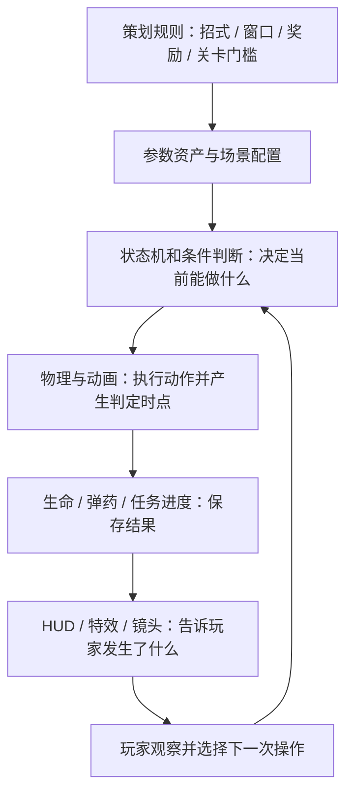

| 方法 | 一句话理解 | 当前项目用在哪里 | 策划上的价值 |
| --- | --- | --- | --- |
| 有限状态机 FSM | 同一时刻由一个主要行为状态负责更新 | 玩家 12 状态、普通敌人状态 | 明确动作权限、进入条件和结束条件 |
| 继承与公共父状态 | 把相同行为写在共同父类 | Entity → Player / Enemy；地面与空中父状态；精英替换部分状态 | 复用已有能力，控制差异范围 |
| 组件化分工 | 生命、战斗、资源、表现分别负责自己的事 | Entity_Health、Player_Combat、弹仓、HUD 等 | 调整一个系统时更容易看清影响范围 |
| 数据驱动 | 把规则参数做成可引用资产 | Attack_Definition、Attack_MoveDefinition、Execution_Definition | 可调整伤害、连线、窗口和处决时序；并非所有数值都已资产化 |
| 图结构 | 节点表示招式，连线表示可选后续 | 三段普攻与 F 派生 | 讨论路线选择，扩展不同连招 |
| 输入缓存与时间窗 | 提前接受有效选择，到规定时点再执行 | 连招派生 | 平衡输入宽容度、动作承诺和节奏感 |
| 动画事件与桥接 | 画面播放到某帧，通知逻辑执行 | 普攻命中、动作结束、普通敌人反击窗口 | 对齐出手与判定时点 |
| 阶段计时 | 按累计时间进入前摇、有效期与收招 | 测试精英、处决时间点 | 明确可反击和可进攻时段 |
| 物理查询与层筛选 | 只检测空间内且属于指定类别的对象 | 射线、圆形攻击、精英矩形攻击 | 让范围与环境条件可视、可调 |
| 接口 | 不同对象遵守同一套接收约定 | IDamgable、ICounterable | 复用攻击处理敌人和机关，同时区分反击资格 |
| C# 事件通知 | 发生某事后通知订阅者 | 玩家死亡、角色翻面 | 解开部分模块间的直接依赖；当前没有全局事件总线 |
| 去重与单次结算 | 同一次机会只发一次伤害或奖励 | HashSet、处决 settled、存活转死亡判断 | 避免多碰撞体重复伤害、尸体刷弹等问题 |
| 占用与统一释放 | 先取得独占使用权，结束时归还 | 处决双方锁定、重力恢复、禁用清理 | 减少打断后角色卡死或残留无敌 |
| 累积器与阈值 | 进度达到门槛才兑换结果 | 100 装填点、三次普通击杀、推进回弹计时 | 控制资源供给和行动频率 |
| 协程与延迟执行 | 等待一段时间或帧末，再继续流程 | 击退、连招重入、重生换角色、闪白 | 组织动作时序与对象生命周期 |
| 预制体复用与重建 | 从同一角色模板生成新的完整实例 | 港口原角色副本、测试房角色副本 | 场景复用角色能力，并获得明确的重开基线 |
| 编辑器工具与自动检查 | 用工具复现搭建并验证规则 | HarborBuilder、CombatTestBuilder、Playtest / Smoke | 减少重复搭场景，留下可回查的验证记录 |

**制作支撑补充：** 港口以裁切后的像素素材组装场景，连续岸墙通过网格和闭合碰撞体形成可走表面；素材使用 Point 过滤与统一 PPU。场景生成脚本用于编辑器搭建，不代表游戏内有随机地图生成系统。特效目前以 Instantiate / Destroy 管理，不是对象池。

依据：[攻击数据](../../Assets/Scripts/Combat)、[接口](../../Assets/Scripts/Interface)、[港口搭建工具](../../Assets/Scenes/HarborVillageV2/Editor/HarborBuilder.cs)、[战斗房搭建工具](../../Assets/Scenes/CombatTest/Editor/CombatTestBuilder.cs)。

## 11 · 当前边界与后续策划落点

### 已有实现，但不能直接等同于完整成品

| 内容 | 当前准确状态 | 讨论下一步时应聚焦 |
| --- | --- | --- |
| 处决动作 | 独立代码状态、独立 Animator 入口；姿势占位 | 专用动画、表现与 0.4 / 0.8 秒时序的匹配 |
| 空中攻击 | 有状态和落地动画；当前片段未配置 AttackTrigger | 是否需要真实伤害，何时判定，能否参与装填 |
| 冲击等级 3 | 枚举范围和分支预留，未实现倒地 | 是否需要倒地 / 起身状态与保护规则 |
| 旧宝箱 | 受击开箱表现；没有掉落配置 | 奖励、重复开启规则、与港口 Q 凭证点的关系 |
| 港口任务 | 一条固定任务链，进度仅在本局内存 | 是否扩展成通用任务、物品系统与存档 |
| 精英攻击 | 固定循环，三招共用原攻击图 | 是否增加新动画、招式配置资产和更多选择逻辑 |
| HUD | 蓝条已有近战装填含义，双弹仓为各 3 格 | 容量变化时同步槽位；区分三种补弹的提示需求 |

### 会影响设计判断的实现限制

- **状态切换不等于旧函数立即停止。** 玩家多个状态已经检查切走后立即返回；普通敌人仍有同帧后续逻辑可能继续写速度或覆盖状态。流程图表达主路径，不能被用作“所有边界已修复”的证明。
- **墙跳锁定仍需核对。** 墙跳计时没有在每次 Enter 重置，末尾墙检测也可能提前回墙滑；不要把注释里的 0.15 秒当作已可靠生效的固定保护期。
- **输入生命周期部分依靠新实例规避。** Player 启用时追加匿名移动回调，反复启用同一实例仍需检查；两个新场景重开采用销毁再生成，并额外释放输入资源。
- **伤害去重有作用域。** 当前玩家普攻是单次查询去重；将来若一招加入多个命中事件，应先决定设计上允许多段命中还是整招只命中一次。

### 适合继续扩写的策划条目

每次新增机制，可沿用以下顺序：**体验目标 → 触发条件 → 状态 / 阶段 → 输入权限 → 判定与数值 → 资源变化 → 反馈 → 打断与失败 → 结束与重置 → 验收用例**。

例如扩写“重击”时，应先确定它如何起手、是否耗弹、能否被冲刺取消、用动画事件还是阶段计时判伤、对失衡有什么影响，再决定接入哪一个招式节点。这样新设计能落到现有系统里。

## 12 · 阅读与证据说明

本次逐项对照了当前 C# 脚本、攻击与处决资产、SampleScene、港口和测试房预制体、相关动画事件及现有说明；未启动 Unity 做新一轮玩法验收。HTML 阅读版中的图由本文 Mermaid 源生成并内嵌，可离线打开；修改本文件后需重新生成阅读版。

现有测试记录：[战斗测试房验收](../Combat/Combat_Test_Room_v0.1_QA.md)、[港口验证记录](../../Assets/Scenes/HarborVillageV2/Preview/Verification.md)。这些是此前的运行证据，不等于本次重新执行的结果。

**与旧总览的差异：** 2026-10-13 的管理文档保留历史盘点，蓝条用途、击杀回弹与处决动画描述已经落后于当前实现。本文采用当前代码与配置：蓝条用于近战装填；普通三杀回一发、处决击杀回一发；处决使用独立 Execution 参数。

相关入口：[项目首页](../../README.md) · [任务看板](../project/TASKS.md) · [近战装填说明](../Combat/Melee_Reload_v0.1.md) · [派生窗口说明](../Combat/Attack_Branch_Window_v0.1.md) · [杀伤弹规则](../Combat/Lethal_Ammo_Rewards_v0.2.md)。
